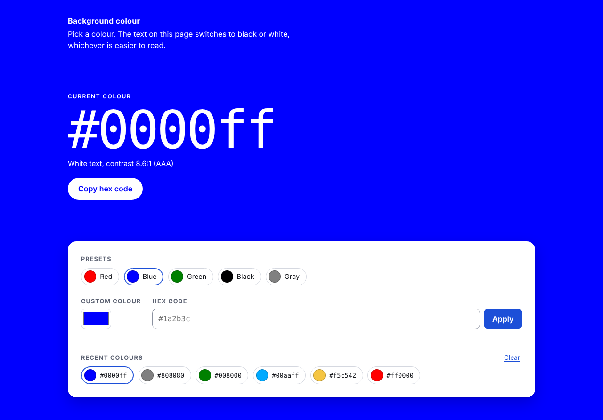
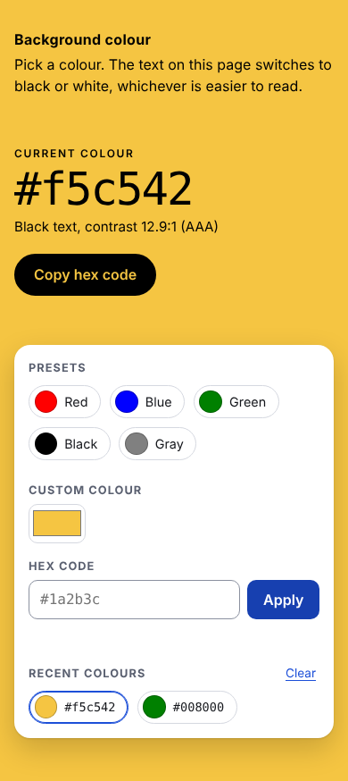

# Background Colour Changer

Pick a background colour for the whole page, copy its hex code, and get text that stays readable on top of it. Plain HTML, CSS and JavaScript. No build step, no dependencies, no CDN.

Live demo: https://bg-color-1l17.vercel.app





## Features

- Five presets from the original app: red, blue, green, black, gray.
- Native colour picker and a hex input (`#abc`, `abc` and `#aabbcc` are all accepted) with inline error messages.
- Text colour switches to black or white automatically, whichever has the higher WCAG contrast ratio. The ratio and the AA/AAA rating are shown on screen.
- Copy button for the current hex code, with a fallback for browsers or contexts without the async clipboard API.
- History of the last 8 colours, stored in `localStorage` on your device. The last colour is restored on reload. "Clear" empties the history.
- Keyboard friendly, visible focus ring that works on any background, screen reader status messages, respects `prefers-reduced-motion`.

## Run it

```sh
python3 -m http.server 5262
# open http://localhost:5262
```

## Tests

The colour maths (hex parsing, contrast ratio, readable text colour, history list) lives in `color.js` and is unit tested with the Node built-in test runner. No packages needed:

```sh
node --test tests/color.test.js
```

## Verification

- `node --test tests/color.test.js`: 5 tests passed (Node 22).
- Headless Chromium (Playwright) at 1280x800 and 390x844: presets, custom hex, invalid hex message, copy to clipboard, history order and persistence after reload all behaved as described, no console errors, no horizontal scroll on mobile.

## Known limitations

- Contrast is checked for the page text against the background only. The white control panel has a fixed colour scheme.
- Text is always pure black or white. A tinted text colour would look nicer but is not computed.

## Notes

UI and code quality improvements were made with AI assistance (Claude, Anthropic), reviewed and verified by building and running the app.
